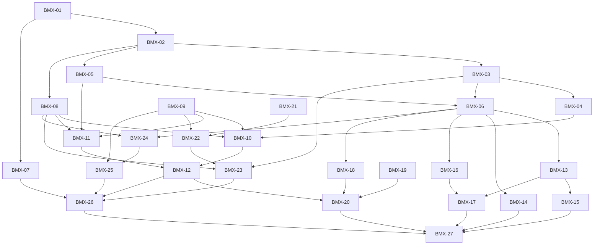

# Tickets del benchmark DeidFlow MX

**Gestor de destino: GitHub Issues de `giovannyTorres/deidflow`.**

**Estado real: documentación y 27 borradores en una rama de revisión; 0 issues creados. BMX-01 a BMX-12 completados y verificados; BMX-13 a BMX-27 permanecen pendientes. BMX-09 registra la ratificación operativa del solicitante, no una aprobación de calidad.**

Rama: [`benchmark/evaluacion-mx-spec-tickets`](https://github.com/giovannyTorres/deidflow/tree/benchmark/evaluacion-mx-spec-tickets). La publicación documental no equivale al registro en GitHub Issues.

La lectura del repositorio por `gh repo view` devolvió HTTP 403 desde api.github.com. La política actual conserva ese host fuera de los destinos permitidos; el borrador del entorno ya lo incluye, pero no está aplicado. La autenticación de Git no demuestra acceso a Issues; tampoco este rechazo demuestra que falte un token.

Estos archivos son cuerpos preparados para GitHub Issues, ahora visibles en GitHub como documentos; no son un cambio al gestor local de markdown. No se inventaron números, URLs, etiquetas aplicadas ni relaciones remotas.

Las solicitudes `/implement` autorizaron BMX-01 y BMX-02, y luego el bloque
BMX-03 a BMX-12. El bloque BMX-03 a BMX-12 está completado y verificado, con implementación
secuencial de las tareas técnicas y ratificación operativa de BMX-09. Actas y evidencia: [lote actual](../../audit/BATCH_NEXT10.md),
[BMX-01](../../audit/BMX-01.md), [BMX-02](../../audit/BMX-02.md). La creación de Issues sigue pendiente del
acceso de red y la posterior comprobación de permisos del repositorio.

Especificación fuente: [DF-EVAL-MX v0.1.0](../../specs/BENCHMARK_MX_SPEC.md).

SHA-256 de la especificación publicada: `898610c7c700f1a1f67154662e2b6526ddbce8fcd7e7f90f43e9631f120ee987`.

La única edición de la especificación para esta publicación actualiza su estado administrativo; conserva requisitos, perfiles pendientes y versión técnica. El manifiesto conserva también el hash previo.

## Criterio de división

Cada tarea técnica añade un resultado observable completo desde una entrada hasta una validación/informe. La primera soporta EMAIL; las demás extienden categorías, pistas o formatos. No hay tareas aisladas de «crear todos los schemas» o «escribir toda la UI». Las cinco tareas humanas resuelven insumos/decisiones reales sin exigirlas a los incrementos descriptivos que no dependen de ellas.

Los bloqueos son prerrequisitos, no una prioridad ni una orden de comenzar. Todos los IDs precedentes existen y el grafo es acíclico. Las referencias locales deben convertirse a vínculos reales al publicar. La etiqueta propuesta clasifica el tipo de trabajo; no elimina sus bloqueos.

## Desglose y dependencias

| ID | Tarea y entrega verificable | Bloqueada por | Tipo |
| --- | --- | --- | --- |
| [BMX-01](01-primer-recorrido-local.md) | **Evaluar un correo de un paquete local a un informe reproducible**. Ejecutar una pista de detección mínima con el reconocedor existente: un caso EMAIL positivo y un documento negativo conocidos producen un informe descriptivo con identificadores opacos, conteos y configuración explícita. Este corte fija la seam paquete/candidato/perfil → informe y no afirma aislamiento estricto ni cobertura de otras capacidades. | Ninguna | Técnica |
| [BMX-02](02-admision-paquete.md) | **Rechazar paquetes inválidos y preservar anotaciones superpuestas**. Extender el recorrido para validar recursos, integridad, referencias y anotaciones antes de evaluar. Un paquete admisible llega al informe; uno inconsistente produce un diagnóstico seguro, sin resultados favorables. | BMX-01 | Técnica |
| [BMX-03](03-deteccion-por-entidad.md) | **Puntuar detección mexicana con matching exacto y errores por entidad**. Evaluar un paquete textual multientidad y publicar filas independientes RFC, CURP, CLABE, tarjetas, teléfonos, correos, personas, direcciones y categorías clínicas declaradas; mantener cobertura parcial como diagnóstico separado. | BMX-02 | Técnica |
| [BMX-04](04-validez-independiente.md) | **Medir validez de identificadores con vectores independientes**. Añadir la pista local de patrón, estructura y checksum de RFC, CURP, CLABE y tarjetas, con vectores ficticios cuya referencia no depende únicamente de los validadores evaluados. | BMX-03 | Técnica |
| [BMX-05](05-transformacion-aislada.md) | **Verificar protección y conservación con menciones de referencia**. Ejecutar transformación textual aislada usando el gold y un perfil explícito; comprobar sustitución real, conservación y mapas de salida sin atribuir fallos del detector a esta pista. | BMX-02 | Técnica |
| [BMX-06](06-pipeline-textual.md) | **Evaluar la salida real del pipeline textual y sus estados**. Medir el pipeline real de detección/transformación con el motor existente, comparando la salida contra referencia y manteniendo aprobación, revisión, bloqueo y ausencia de salida separados. | BMX-03, BMX-05 | Técnica |
| [BMX-07](07-ejecucion-segura.md) | **Ejecutar con aislamiento local, límites y diagnósticos sin datos**. Hacer ejecutable y verificable la restricción local del arnés, con límites por proceso/caso y capacidades de aislamiento declaradas; mantener los fallos en el informe. | BMX-01 | Técnica |
| [BMX-08](08-independencia-particiones.md) | **Auditar particiones por grupos, linajes y exposición**. Admitir como independiente solo un paquete con auditoría verificable de grupos y exposición, distinguiendo entrenamiento, ajuste, calibración, regresión, transferencia y test ciego. | BMX-02 | Técnica |
| [BMX-09](09-ratificar-perfiles.md) | **Ratificar perfiles operativos, sensibilidad y conservación**. Resolver con el responsable las decisiones D1–D3 y el alcance obligatorio por formato, dejando perfiles documentados y versionados antes de producir referencia de calificación. | Ninguna | Humana |
| [BMX-10](10-corpus-identificadores.md) | **Preparar corpus sintético mexicano de identificadores y negativos**. Producir un paquete de identificadores mexicanos completamente ficticios con validez comprobada independientemente, negativos difíciles, familias diferenciadas y soporte reportado. | BMX-04, BMX-08, BMX-09 | Técnica |
| [BMX-11](11-corpus-contextual.md) | **Evaluar nombres, direcciones, clínica y homónimos con referencia adjudicada**. Preparar casos ficticios contextuales que permitan medir tanto detección como conservación, con identidad y ambigüedad explícitas en lugar de adivinadas. | BMX-05, BMX-08, BMX-09 | Técnica |
| [BMX-12](12-perturbaciones.md) | **Evaluar perturbaciones textuales sin romper linaje ni referencia**. Generar derivados deterministas de formato/ruido textual, vinculados a su origen y evaluables como pistas separadas del texto limpio y del OCR real. | BMX-10, BMX-11 | Técnica |
| [BMX-13](13-estructurados.md) | **Verificar salidas CSV/TSV y JSON/JSONL reales**. Extender el pipeline a datos estructurados con localizadores estables y comprobación de valores, esquema, índices y metadatos que puedan conservar información. | BMX-06 | Técnica |
| [BMX-14](14-docx.md) | **Detectar fugas en contenido recuperable de DOCX**. Añadir un inspector de referencia DOCX que compruebe texto y slots recuperables del artefacto, con la regresión conocida del correo oculto en un atributo. | BMX-06 | Técnica |
| [BMX-15](15-xlsx.md) | **Verificar celdas y copias recuperables en XLSX**. Extender el evaluador estructurado a XLSX sin limitarse a la cuadrícula visible, verificando canales recuperables y contexto tabular conservado. | BMX-13 | Técnica |
| [BMX-16](16-html.md) | **Verificar contenido HTML y atributos recuperables**. Medir las salidas HTML usando un inventario de texto/atributos y canales admitidos, con conservación y revisión propia del formato. | BMX-06 | Técnica |
| [BMX-17](17-eml.md) | **Verificar MIME, cabeceras y adjuntos admitidos**. Añadir evaluación de mensajes ficticios y sus adjuntos mediante inspectores disponibles; informar explícitamente los tipos que aún no pueden verificarse. | BMX-13, BMX-16 | Técnica |
| [BMX-18](18-pdf-nativo.md) | **Verificar PDF nativo y reconstrucción visual con gold controlado**. Evaluar PDFs sintéticos con referencia textual y geométrica, inspeccionando la reconstrucción y el contenido recuperable en vez de confiar en la extracción del candidato. | BMX-06 | Técnica |
| [BMX-19](19-activos-ocr.md) | **Revisar y registrar activos locales de OCR sin descargas automáticas**. Dejar disponibles los binarios, idiomas y licencias necesarios para la integración OCR real, o documentar exactamente qué requisito externo falta. | Ninguna | Humana |
| [BMX-20](20-ocr-real.md) | **Medir OCR real y privacidad del pipeline de imágenes sintéticas**. Comparar referencia visual, texto OCR observado, detección y salida transformada usando únicamente imágenes ficticias y activos OCR locales fijados. | BMX-12, BMX-18, BMX-19 | Técnica |
| [BMX-21](21-fuentes-permisos.md) | **Revisar permisos y contenido no personal de fuentes públicas**. Seleccionar fuentes candidatas para español mexicano y documentar legalidad/alcance antes de cualquier incorporación; el registro actual no constituye permiso automático. | Ninguna | Humana |
| [BMX-22](22-adjudicacion.md) | **Acordar y aplicar la referencia de anotación pública admitida**. Definir y realizar la anotación/adjudicación de una muestra admitida sin usar predicciones como verdad, dejando reglas y desacuerdos auditables. | BMX-09, BMX-21 | Humana |
| [BMX-23](23-importacion-publica.md) | **Evaluar anotaciones públicas admitidas sin mezclarlas con el test ciego**. Importar únicamente datos locales autorizados y anotados, validarlos y publicar sus métricas con geografía, alcance y exposición correctos. | BMX-03, BMX-08, BMX-22 | Técnica |
| [BMX-24](24-estadistica.md) | **Informar soporte, intervalos por grupo y límites de riesgo residual**. Añadir agregación estadística reproducible que respete grupos y denominadores, incluida la incertidumbre cuando no se observan fugas o falta verificación. | BMX-06, BMX-08 | Técnica |
| [BMX-25](25-calidad-custodia.md) | **Ratificar calidad, soporte y custodia antes de abrir el test**. Fijar el perfil de calidad y la gobernanza del banco independiente antes de conocer sus resultados, sin fabricar porcentajes de aprobación profesional. | BMX-09, BMX-24 | Humana |
| [BMX-26](26-banco-independiente.md) | **Congelar un banco independiente con trazabilidad de exposición**. Preparar bajo custodia el banco de evaluación final con grupos disjuntos, referencia adjudicada, soporte y configuración congelados antes de medir al candidato. | BMX-07, BMX-12, BMX-23, BMX-25 | Técnica |
| [BMX-27](27-calificacion-integrada.md) | **Emitir una calificación local reproducible y comprobar empaquetado**. Cerrar el recorrido completo con la matriz de capacidades obligatorias, informe verificable y compatibilidad de distribución. La aceptación del arnés no exige fingir que el candidato actual pasa calidad. | BMX-14, BMX-15, BMX-17, BMX-20, BMX-26 | Técnica |

## Frontera inicial

- **BMX-01**: único incremento técnico sin bloqueos.
- **BMX-09**, **BMX-19**, **BMX-21**: decisiones de perfiles, activos OCR y permisos de fuentes pueden trabajarse sin esperar al arnés.
- Esta era la frontera al crear las tareas. El bloque solicitado BMX-03 a BMX-12 ya terminó, incluida la ratificación
  operativa de BMX-09, que exige todos los formatos previstos. BMX-13/14/16/18/24 tienen
  prerrequisitos técnicos satisfechos; BMX-19/21 son insumos humanos pendientes.
  Esta frontera no autoriza iniciar las tareas posteriores.

## Grafo

## Cobertura de criterios de la especificación

| Criterio | Tickets responsables |
| --- | --- |
| AC-01 | BMX-02, BMX-08, BMX-26, BMX-27 |
| AC-02 | BMX-03, BMX-27 |
| AC-03 | BMX-03, BMX-10, BMX-23, BMX-27 |
| AC-04 | BMX-04, BMX-09, BMX-10, BMX-27 |
| AC-05 | BMX-02, BMX-03, BMX-11, BMX-12, BMX-22, BMX-27 |
| AC-06 | BMX-05, BMX-06, BMX-13, BMX-14, BMX-15, BMX-16, BMX-17, BMX-18, BMX-27 |
| AC-07 | BMX-14, BMX-27 |
| AC-08 | BMX-05, BMX-06, BMX-09, BMX-11, BMX-22, BMX-27 |
| AC-09 | BMX-06, BMX-24, BMX-27 |
| AC-10 | BMX-07, BMX-13, BMX-14, BMX-15, BMX-16, BMX-17, BMX-18, BMX-19, BMX-20, BMX-24, BMX-27 |
| AC-11 | BMX-07, BMX-16, BMX-17, BMX-19, BMX-20, BMX-26, BMX-27 |
| AC-12 | BMX-01, BMX-10, BMX-12, BMX-20, BMX-24, BMX-26, BMX-27 |
| AC-13 | BMX-01, BMX-06, BMX-09, BMX-25, BMX-27 |
| AC-14 | BMX-08, BMX-12, BMX-21, BMX-22, BMX-23, BMX-25, BMX-26, BMX-27 |
| AC-15 | BMX-27 |

## Publicación en el gestor configurado

1. Aplicar en ajustes del entorno el destino api.github.com ya preparado en el borrador. No se modificó ni publicó el entorno en esta tarea.
2. Repetir la lectura del repositorio, comprobar Issues habilitado y permisos de escritura; no solicitar nuevas credenciales basándose solo en el 403 de red.
3. Leer issues abiertos/cerrados y etiquetas existentes para detectar duplicados mediante el marcador estable de cada cuerpo y el prefijo del título. Ningún listado de Issues pudo completarse aquí; la lectura y escritura por Git sí se verificaron para publicar esta rama.
4. Revisar granularidad, bloqueos y separación de tareas humanas/técnicas antes de la publicación; conservar la evidencia de BMX-01 a BMX-12 sin empezar otros incrementos.
5. Crear un issue por tarea en orden topológico, con cuerpo desde archivo UTF-8; retirar antes las cabeceras administrativas de borrador y resolver sus bloqueos a números reales usando los issues ya creados. Aplicar la etiqueta configurada según el tipo, comprobando antes si existe. No crear un issue padre ficticio ni cerrar/modificar un padre existente.
6. Registrar número, ID de base de datos y URL realmente devueltos; no inferirlos del ID BMX. Resolver los bloqueos mediante dependencias nativas de GitHub; con gh 2.46 utilizar el endpoint REST documentado, no flags de versiones recientes.
7. Si la función nativa no está disponible, escribir Blocked by con números y enlaces reales en cada cuerpo y declarar el fallback. No afirmar vínculos nativos que no existen.
8. Releer cada issue y sus relaciones para verificar persistencia. Ante un fallo parcial, reanudar por marcadores/IDs guardados, sin duplicar tickets.

La única acción externa pendiente ahora es habilitar el acceso necesario al gestor; los cuerpos, criterios, pruebas y grafo ya están preparados. Las comprobaciones de permisos y persistencia se realizan después de ese cambio real.

## Revisión previa y alcance

La granularidad busca una sesión con contexto fresco por tarea técnica. Si la experiencia revela una tarea demasiado grande, dividir por un comportamiento verificable antes de implementarla, conservando trazabilidad y sin fabricar dependencias.

Al crear el desglose se comprobó su coherencia documental: hashes, enlaces,
cobertura de AC y dependencias. Las tareas BMX-01 a BMX-12 incorporan
recorridos, admisión, métricas, aislamiento, corpus ficticios y perturbaciones,
con pruebas y evidencia enlazadas arriba. Los criterios asignados a BMX-13 a
BMX-27 siguen siendo trabajo futuro. El manifiesto distingue el estado de implementación de
la publicación pendiente en GitHub Issues y conserva los hashes de los cuerpos.
